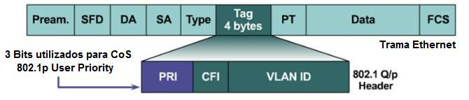
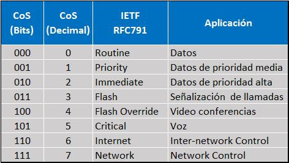
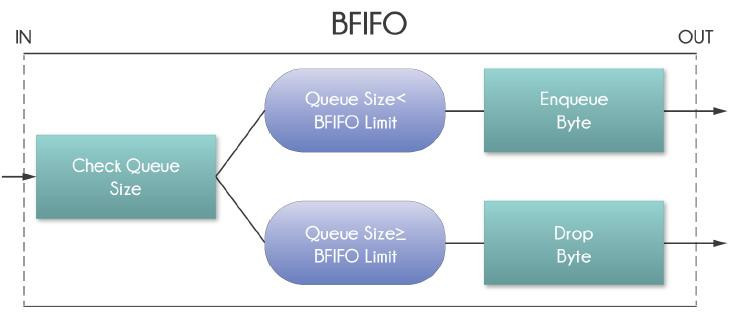
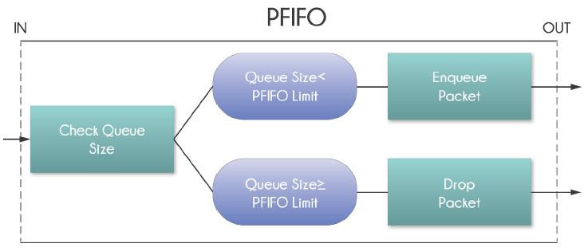
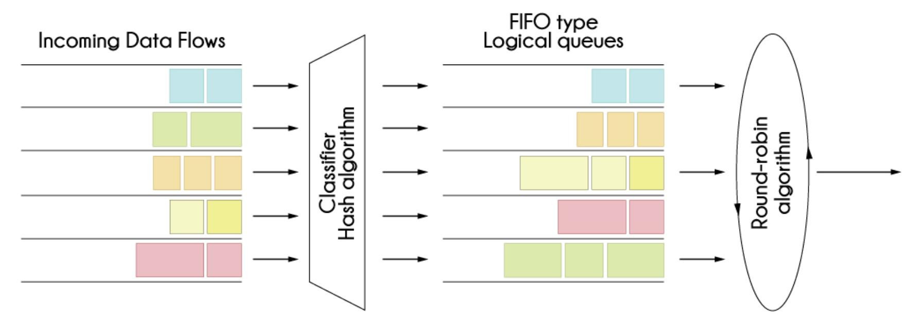
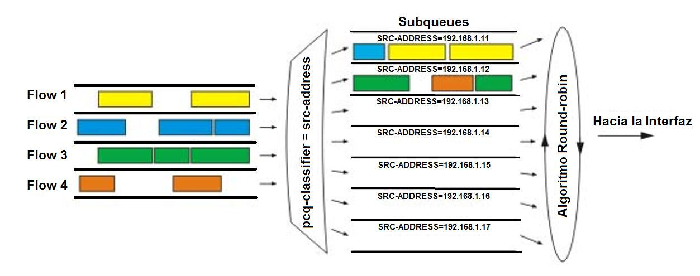
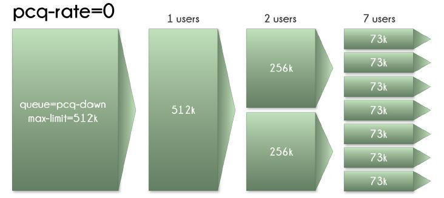
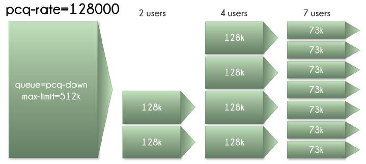
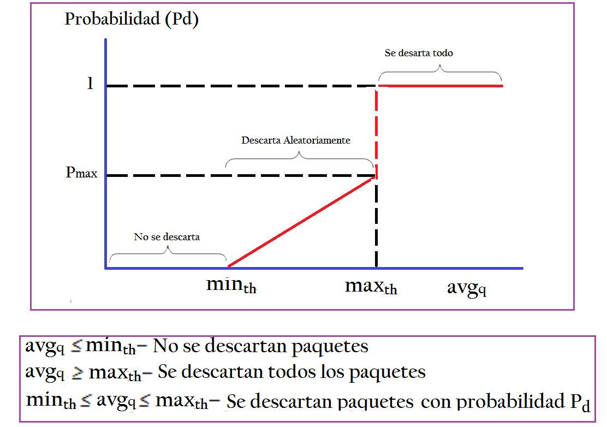

# Calidad de Servicio - QoS (Quality of Service)

La calidad de servicio se define como la capacidad de una red para reconocer los diferentes requisitos de servicio del tráfico de aplicaciones que fluyen a través de ella y cumplir así con los SLA (Service Level Agreement - Acuerdo de Nivel de Servicio) negociados para cada uno de los servicios de la aplicación, mientras se intenta maximizar la utilización de los recursos de la red. QoS es absolutamente esencial en una red multiservicio, para cumplir con los SLA de diferentes servicios y maximizar la utilización de la red.

Sin QoS, los datagramas son atendidos en una red en modo FIFO (First-in, First-out) es decir, el primero en entrar es el primero en salir, también conocido como servicio Best-Effort, esto significa que el router realizará el mejor esfuerzo por entregar el datagrama a su destino, pero no puede garantizar la entrega, es decir que en esta modalidad el datagrama puede entregarse o no al destino. En tal escenario, no se asigna prioridad a los datagramas, como resultado, no es posible brindar un tratamiento diferencial al tráfico de las distintas aplicaciones.

Aunque los flujos de tráfico de red son de naturaleza dinámica, QoS permite al proveedor de servicios maximizar la utilización de los recursos de red al proporcionar acceso prioritario al ancho de banda de la red para el tráfico de alta prioridad y permitir al mismo tiempo que el tráfico de baja prioridad pueda utilizar todo el ancho de banda en ausencia de tráfico de alta prioridad.

RouterOS ofrece métodos avanzados para controlar el tráfico, puede poner el tráfico en cola y controlarlo en función de las direcciones IP individuales, dando a cada dirección IP su propia cola, sus propias capacidades de ráfagas, todas basadas en velocidades ascendentes y descendentes, o una velocidad total. También puede distribuir de manera uniforme el tráfico entre las IP en subredes dadas utilizando el método de cola PCQ, todo con una sola IP.

RouterOS, sin embargo, no se detiene allí; puede identificar el tráfico por tipos, incluidos protocolos, puertos, direcciones IP de origen o destino, tráfico de igual a igual, así como mediante la inspección de paquetes con estado o las reglas de identificación de Capa 7. Con todas estas capacidades, puede crear un sistema de colas extremadamente sofisticado que puede proporcionar una calidad de servicio avanzada (QoS) para los datos de sus clientes, ¡según el método que desee!

## Convergencia de Redes y QoS

Actualmente las redes de datos soportan diferentes tipos de aplicaciones que brindan servicios de datos, voz y vídeo sobre una infraestructura de red común. Independientemente de la tecnología o protocolos utilizados, las redes imponen ciertas restricciones sobre el tráfico que fluye a través de la red.

Las restricciones notables que afectan el rendimiento de las aplicaciones de una red son: **Throughput** (ancho de banda disponible), **Delay** (retraso de extremo a extremo), **Jitter** (variación del retraso) y **Packet Loss** (pérdida de paquetes).

Los diferentes tipos de aplicaciones pueden tolerar cada una de estas restricciones en diferente medida. Por lo tanto, para mantener un cierto grado de calidad en una aplicación, las restricciones de red impuestas a su tráfico deben ser lo suficientemente tolerables para la aplicación.

### Throughput - Ancho de Banda

Los datagramas fluyen por la red utilizando el camino con el mejor ancho de banda disponible, el cual estará determinado por el menor ancho de banda disponible en un camino determinado.

Por ejemplo, imaginemos que tenemos que transportar agua por un sistema de cañerías que está compuesto por caños de diferente diámetro. De este modo, el caudal del agua está determinado por la tubería con el diámetro más pequeño. En otras palabras, el caudal del agua es la velocidad a la que el agua puede fluir a través de la tubería con el diámetro más pequeño.

El no disponer del ancho de banda necesario hace que la calidad de las aplicaciones se degrade debido al retraso y a la pérdida de los paquetes. Esto es evidente de manera casi inmediata en las aplicaciones de voz y video.

Se pueden utilizar algunos de los siguientes recursos para resolver los problemas relacionados al ancho de banda:

* Incrementar el ancho de banda de los enlaces, lo cual si bien es efectivo, es una solución costosa, por lo que no siempre es una solución disponible para implementar en el corto plazo.
* Implementar calidad de servicio (QoS) para clasificar, marcar y priorizar el tráfico de modo que los paquetes más importantes tengan prioridad y se envíen antes que el tráfico menos importante.

### Delay - Retraso

RFC 2679 define una métrica para medir el retraso unidireccional como la diferencia de tiempo en que un datagrama cruza dos puntos de referencia. El retraso de un datagrama experimentado dentro de una red de proveedor de servicios se define como la diferencia entre el momento en que el datagrama ingresa a la red y el momento en que sale de la red. El retraso también se conoce comúnmente como latencia.

Cada elemento a través del cual fluye un datagrama en una ruta de tráfico aumentará el retraso experimentado por el datagrama. Podemos identificar distintos tipos de retraso en ese camino:

* **Retraso de procesamiento:** es el tiempo que tarda un elemento de red (router o switch) en mover un datagrama desde la interfaz de entrada a la interfaz de salida. Este tipo de retraso está directamente relacionado a la capacidad de procesamiento del equipo.
* **Retraso de encolamiento:** es el tiempo que le lleva a un datagrama pasar por las colas asociadas a la interfaz de salida. Este retraso dependerá de la carga del router, de la cantidad de datagramas esperando en la cola, del tipo de cola, y del ancho de banda de la interfaz.
* **Retraso de serialización:** tiempo empleado en poner los bits de una trama en el medio físico.
* **Retardo de propagación:** tiempo que se tarda en transmitir los bits por el medio físico que conecta los equipos de red.

### Jitter - Variación del retardo

RFC 3393 ha definido una métrica para medir el jitter unidireccional. Jitter es la variación en el retraso de la red que experimentan los datagramas. Más específicamente, se mide como la variación de retraso entre dos datagramas consecutivos que pertenecen al mismo flujo de tráfico. El jitter se produce cuando los datagramas llegan al destino a diferentes velocidades a las que fueron emitidos en el origen.

Tomando como ejemplo una aplicación de video o voz, es esencial que la aplicación en el destino sea capaz de liberar los datagramas a la misma velocidad y en el mismo orden en que fueron emitidos en el origen. Esto se puede lograr valiéndose del buffer donde se van almacenando los datagramas que llegan al router y del protocolo de la capa de transporte que asegure que se entreguen en orden.

Incrementar el ancho de banda y/o priorizar los paquetes son algunos de los puntos a tener en cuenta para ayudar a reducir el jitter.

### Packet Loss - Pérdida de Paquetes

En el RFC 2680 y RFC 3357 se ha definido una métrica para medir la pérdida de tráfico unidireccional. La pérdida de tráfico caracteriza las pérdidas de datagramas que ocurren en la ruta de un flujo de tráfico unidireccional entre dos puntos de referencia: uno al principio cuando el tráfico ingresa a una red y el otro al final cuando el tráfico sale de la red.

Aunque tener espacio en el buffer de memoria para poner temporalmente los paquetes en cola ayuda a reducir la pérdida de paquetes, no puede eliminarse por completo. Algunos de los factores que contribuyen a la pérdida de paquetes son:

* **Congestión:** el tráfico en ráfagas puede causar desbordamientos de las colas, que resultan en la pérdida de paquetes.
* **Errores en la capa física:** el ruido en los medios físicos puede causar errores de bit. Como resultado, los protocolos de las capas superiores pueden descartar paquetes.
* **Fallas en los equipos de red:** las fallas en los elementos de la red pueden hacer que se pierdan paquetes hasta que se detecte la falla y se restablezca la conectividad.

## Fundamentos de QoS

Para implementar un modelo de QoS en una red en general y más particularmente para DiffServ, las siguientes características son esenciales:

* Clasificación de tráfico
* Gestión de colas y almacenamiento (buffering)
* Scheduling
* Rate-Limiting (Limitación de velocidad)

### Clasificación de Tráfico

El tratamiento de los paquetes será diferente según su clasificación. A medida que el tráfico llega a la entrada de acceso, los datagramas se clasifican en diferentes clases de reenvío y, dentro de una clase de reenvío, en prioridad de cola alta o baja.

La clasificación del tráfico puede basarse en múltiples campos de encabezado, los datagramas pueden marcarse con la marca estándar de ToS, por lo que en los nodos posteriores, el tráfico se clasifica de acuerdo con la marca estándar presente en el campo de ToS.

### Manejo de Colas y Buffer

Los datagramas que fluyen a través de un router también puede que deban esperar antes de ser servidos por el scheduler hacia sus respectivos destinos. La espera es inevitable, si la velocidad de llegada de los datagramas destinados a un puerto de salida particular es mayor que la velocidad a la que salen.

En términos de redes, este período de espera se conoce como queuing-delay o latencia.

Por otro lado, el datagrama que pertenece a una clase de tráfico de alta prioridad tendrá asegurado el espacio de almacenamiento en buffer.

### Scheduling

La función de scheduling dentro de un router decide el orden en que se atienden las colas que pertenecen a diferentes forwarding classes (clases de reenvío). Por lo general, las colas que pertenecen a clases de reenvío de alta prioridad son servidas antes que las colas que pertenecen a clases de reenvío de baja prioridad.

### Rate-Limiting

Una ruta de red tiene un ancho de banda limitado para transportar tráfico. Los proveedores de servicios intentan maximizar la utilización del ancho de banda de sus redes para maximizar la generación de ingresos.

Los proveedores de red sobrecargan las clases de tráfico de baja prioridad, permiten a los clientes utilizar el exceso de ancho de banda cuando esté disponible y ofrecen servicios best-effort para maximizar la utilización del ancho de banda de la red.

Existen diferentes enfoques para limitar la velocidad y cada uno tiene sus propias aplicaciones específicas. Los enfoques de limitación de velocidad más populares son policing y shaping.

#### Policing

Cuando el tráfico que llega de un cliente excede constantemente una cierta tasa negociada a través de un SLA (Acuerdo de Servicio), los datagramas en exceso serán descartados. Este enfoque de limitación de velocidad se conoce como policing.

#### Shaping

Debido a las latencias variables experimentadas por los datagramas de un flujo de tráfico a medida que fluyen a través de una red, puede que algunos de los datagramas arriben todos juntos y ocasionen que el flujo sea temporalmente no conforme.

La función de shaping almacena dichos datagramas no conformes en una cola y los retira a la velocidad de conformidad. Por lo tanto, esta configuración puede ayudar a que un flujo de tráfico que experimenta una no conformidad temporal pase a través de un router que esté realizando policing.

**Policing vs. shaping, ¿cuándo usar cada uno?** La diferencia práctica es que policing descarta el exceso (más simple, pero genera retransmisiones y puede ser más agresivo con TCP), mientras que shaping retrasa el exceso en una cola para suavizar el flujo (más amigable para aplicaciones sensibles a pérdida, pero agrega latencia/jitter si la cola crece). En RouterOS, las colas simples y el queue tree implementan shaping; el policing puro es menos común y suele lograrse limitando directamente el tamaño de la cola.

## Clasificación y Marcado de tráfico

### Clasificación de tráfico

Clasificar es el proceso de identificar y categorizar tipos de tráfico en clases. Es posible utilizar los siguientes criterios para categorizar el tráfico:

* Interfaz de entrada
* Valor de CoS/ToS
* Dirección IP de Origen o Destino
* Valor de IP Precedence (DSCP) en la cabecera IP
* Valor EXP en la cabecera MPLS
* Tipo de Aplicación

### Marcado de tráfico

Marcar es el proceso de etiquetar el tráfico basándose en su categoría. Los campos utilizados para marcar el tráfico dependen de la capa que se utilice, en el caso de la capa 2 (CoS, EXP) y en caso de capa 3 (IP Precedence y DSCP).

Siempre se debe clasificar y marcar el tráfico tan cerca del origen como sea posible.

### CoS en la trama Ethernet (802.1p)

Class of Service (CoS) permite administrar el tráfico en una red al agrupar tipos similares de tráfico (por ejemplo, correo electrónico, transmisión de vídeo, voz, transferencia de archivos, control de red) y tratar cada tipo como una clase con su propio nivel de prioridad de servicio. Mediante el uso de CoS es posible clasificar y priorizar el tráfico a los fines de implementar calidad de servicio (QoS).

Hay tres tecnologías principales de CoS:

* 802.1p Layer 2 Tagging
* Type of Service (ToS)
* Differentiated Services (DiffServ)

CoS es un campo de 3 bits que está presente en un encabezado de trama Ethernet cuando está presente el etiquetado VLAN 802.1Q. CoS opera en la capa de enlace de datos (capa 2).



El campo especifica un valor de prioridad entre 0 y 7, más comúnmente conocido como CS0 a CS7, que puede ser utilizado por las disciplinas de calidad de servicio (QoS) para diferenciar y controlar el tráfico de la red.



Los routers pueden configurarse para usar los valores de CoS existentes en los paquetes que le ingresan desde otros dispositivos (modo de confianza), o pueden reescribir el valor de CoS en algo completamente diferente. La mayoría de los diseños de QoS no confían en las marcas entrantes de QoS de sus clientes, por lo que CoS generalmente se limita a su uso dentro de la intranet de una organización.

### IP Precedence - Type of Service (ToS)

Los paquetes IP tienen en su encabezado (header) un campo llamado Tipo de Servicio (Type of Service) o simplemente ToS. ToS se definió en el RFC 791 en 1981, pero la forma en que se utiliza ha cambiado a lo largo de los años.


Los primeros 3 bits se utilizan para definir una precedencia. Cuanto mayor sea el valor, más importante es el paquete IP; en caso de congestión, el router descartará primero los paquetes de baja prioridad.

El segundo campo, etiquetado "TOS", denota cómo la red debe hacer compensaciones entre el rendimiento, el retraso, la confiabilidad y el costo.

### Differentiated Services Code Point (DSCP)

La redefinición del byte ToS en 1998 con la RFC 2474 describe un byte ToS diferente, que dio lugar al campo DiffServ, que utiliza los 6 bits más significativos (de izquierda a derecha).

Los seis bits superiores contienen un valor denominado Differentiated Services Code Point (DSCP). Los dos últimos bits se utilizan para la Notificación Explícita de Congestión (Explicit Congestion Notification). Se han estandarizado cuatro tipos diferentes de DiffServ PHB (Per Hop Behaviour - Comportamiento por Salto).

RFC 2474, que definió DSCP, también definió dos tipos de PHB: el PHB predeterminado Best Effort (BE) y los PHB de selector de clase - Class Selector (CS).

Más tarde, en 1999, el RFC 2597 definió el PHB de reenvío asegurado Assured Forwarding (AF) para reenviar el tráfico de datos.

También en 1999, el RFC 2598 definió el PHB de Expedited Forwarding (EF) para el reenvío de tráfico en tiempo real.

Dado que el campo DSCP se superpone con el campo IP Precedence, el RFC 2475 define un conjunto de valores DSCP y PHB llamados PHB Class Selectors (CS) que proporcionan compatibilidad con IP Precedence. De este modo, si un router establece el valor CS DSCP, tendrá sentido desde una perspectiva IP Precedence para aquellos dispositivos que solo entienden el campo IP Precedence.

#### Assured Forwarding (AF)

Estas clases son adecuadas para transportar tráfico de aplicaciones de datos con un ancho de banda mínimo garantizado. Cada una de las cuatro clases admite tres niveles de probabilidad de descarte de paquetes. Es decir que en una situación de congestión, cuanto mayor sea la probabilidad, mayores serán las posibilidades de que el paquete se descarte.

Las cuatro clases con sus tres niveles de probabilidad de descarte y los 12 PHB resultantes se resumen a continuación.

#### Expedited Forwarding (EF)

EF PHB es adecuado para transportar tráfico de aplicaciones de datos que requieren un servicio de red de baja pérdida, baja latencia y bajo jitter. En otras palabras, EF PHB es adecuado para el tráfico de aplicaciones sensibles al tiempo y a la pérdida de paquetes, como lo son las aplicaciones de tiempo real para voz y video.

El estándar también sugiere que si EF PHB se implementa de manera tal que el tráfico EF tenga prioridad de servicio por sobre cualquier otro tipo de tráfico, entonces al tráfico EF se le debe aplicar policing a una tasa de transferencia comprometida para limitar el impacto del tráfico EF sobre otros tipos de tráfico y para proteger también contra ataques de denegación de servicio (DoS). Cualquier paquete que exceda la tasa de transferencia definida debe ser descartado.

## Gestión de Colas y Almacenamiento (Buffering)

### Colas (Queues)

El queuing (encolado) maneja la manera en que los paquetes están esperando por su turno para salir de la interfaz. Las disciplinas de encolamiento controlan el orden y velocidad en que los paquetes van saliendo a través de la interfaz, adicionalmente definen qué paquetes deben esperar por su turno para ser enviados y cuáles deben ser descartados, en función de la disciplina que se tenga implementada.

Las colas se utilizan para limitar y priorizar el tráfico:

* Limitar la velocidad para ciertas direcciones IP, subredes, protocolos, puertos y otros parámetros.
* Limitar el tráfico peer-to-peer.
* Priorizar el flujo de algunos paquetes sobre otros.
* Configurar el tráfico Burst para una navegación (browsing) más rápida.
* Aplicar diferentes límites basados en tiempo.
* Compartir el tráfico disponible de manera equitativa entre usuarios, o dependiendo de la carga del canal.

La implementación de colas en RouterOS se basa en HTB (Hierarchical Token Bucket). HTB permite crear una estructura de cola jerárquica y determina las relaciones entre las colas (el detalle completo de cómo funciona HTB, incluyendo CIR/MIR y queue trees, se desarrolla en la sección [Hierarchical Token Bucket (HTB)](#hierarchical-token-bucket-htb) más adelante). En RouterOS, estas estructuras jerárquicas se pueden encontrar en 4 lugares diferentes:

* **global-in** – Representa a todas las interfaces de entrada en general (INGRESS queue). Las colas unidas a global-in aplican al tráfico que es recibido por el router antes del filtrado de paquetes.
* **global-out** – Representa a todas las interfaces de salida en general (EGRESS queue).
* **global-total** – Representa a todas las interfaces juntas de entrada y de salida (en otras palabras, es la agregación de global-in y global-out). Se utiliza en los casos en que los clientes tienen un límite único para ambas, subida y bajada (upload y download).
* **\<interface name\>** – Representa una interfaz de salida en particular. Únicamente el tráfico que se designa para salir a través de esta interfaz pasará por esta cola HTB.

Existen dos formas diferentes de configurar colas en RouterOS:

* `/queue simple` (colas simples) – Diseñado para facilitar la configuración de las tareas de gestión de colas simples y cotidianas (tales como la limitación de un solo cliente de upload/download, limitación de tráfico p2p, etc.).
* `/queue tree` (árbol de colas) – Para implementar tareas de encolamiento avanzadas (tales como políticas de priorización global, limitaciones de grupos de usuarios).

### Colas Simples

Las colas simples están diseñadas para simplificar la vida del administrador al proporcionar una única cola para subredes y direcciones IP individuales o múltiples.

La configuración más sencilla de una cola simple es colocar una dirección de destino como la IP en la que se desea controlar el ancho de banda, luego se pueden establecer `limit-at` y `max-limit`.

Las colas simples tienen características integradas útiles:

* Colas de tráfico peer-to-peer
* Aplicación de reglas de colas en intervalos de tiempo elegidos
* Prioridades
* Uso de múltiples marcas de paquetes de `/firewall ip mangle`
* Shaping (programación) de tráfico bidireccional (un límite para el total de subida + bajada)

La cola simple creará en realidad entre cero y tres colas, posiblemente creando colas Global-Total, Global-In y/o Global-Out. En realidad, estos se crean en el árbol de colas (queue tree), pero no se ven directamente.

Si se crean varias reglas en las colas simples, y luego se revisa el árbol de colas, se verá algo en la parte inferior como "0 de 2", o "0 de 8", etc. Será una lista en blanco, pero el "8" (o el segundo número) es el número de colas ocultas dinámicas creadas en función de las colas simples configuradas.

Si todas las propiedades de una cola tienen valores por defecto (no hay límites establecidos, tipo de cola por defecto), y la cola no tiene hijos, entonces no se crea realmente.

Las colas simples tienen orden estricto: cada paquete debe pasar por cada cola hasta que cumpla las condiciones (en el caso de 1000 colas, un paquete para alcanzar el final de la lista tendrá que pasar a través de 999 colas antes de llegar a su destino).

**Ejemplo de configuración**

Asumamos que queremos limitar la bajada y la subida para una red privada (upload = 256kbps, download = 512kbps).

Para esto se debe agregar una regla de cola simple, la cual limitará el tráfico de bajada a 512kbps y subida a 256kbps para la red IP definida, configurada en una interfaz dada:

```
/queue simple add name=private target=192.168.10.0/24 max-limit=256K/512K interface=ether2
```

En este caso la declaración funciona bien incluso si se indica solamente uno de los parámetros `target` o `interface`, porque ambos definen dónde y para qué tráfico se implementará esta cola.

Se puede verificar la configuración con el comando:

```
/queue simple print
```

```
Flags: X - disabled, I - invalid, D - dynamic
0 name="private" target=192.168.10.0/24 dst-address=0.0.0.0/0
interface=ether2 parent=none direction=both priority=8
queue=default-small/default-small limit-at=0/0 max-limit=256k/512k
burst-limit=0/0 burst-threshold=0/0 burst-time=0s/0s
total-queue=default-small
```

El parámetro `max-limit` reduce el ancho de banda máximo disponible. El valor `max-limit=256k/512k` significa que los clientes de la red privada recibirán máximo 512kbps para descarga y 256 kbps para subida.

El `target` permite definir la fuente de direcciones IP a la que se aplicará la regla de colas.

En caso de agregar una cola con `max-limit=0/0`, indica que para esa cola no hay ninguna limitación. Se debe mover esta regla al principio de la lista, ya que los elementos de las colas simples se ejecutan en orden uno por uno. Si el router encuentra una regla que satisface ciertos paquetes, las siguientes reglas ya no se comparan.

**Identificadores de Flujo**

* `target` (multiple choice: IP address/netmask): lista de rangos de direcciones IP que serán limitadas por esta cola.
* `interface` (nombre de la interfaz, o `all`): identifica la interfaz en la que el objetivo (target) está conectado. Esta opción es útil cuando no es posible especificar las direcciones objetivo (target).

A partir de RouterOS v6 los identificadores de flujo `interface` y `target` se combinan en la opción `target`, donde se puede especificar cualquiera de los anteriores.

### Principios de limitación de velocidad

La limitación de velocidad se utiliza para controlar la velocidad de flujo de tráfico enviado o recibido en una interfaz de red.

El tráfico cuya tasa de transferencia es menor o igual a la tasa especificada será enviado, mientras que el tráfico que supera dicha tasa será descartado o retrasado.

La limitación de velocidad se puede realizar de dos maneras:

* **Policing:** consiste en descartar todos los paquetes que excedan el límite de velocidad. La limitación de velocidad será del 100% cuando el tamaño de la cola sea igual a 0.
* **Shaping:** consiste en retardar los paquetes que exceden el límite de velocidad específico de la cola, para que sean transmitidos cuando sea posible. Cuando el tamaño de la cola tiende a ser ilimitado, la tasa de shaping tenderá al 100%.

### Congestión y Colas

La congestión ocurre cuando el ritmo con el que llegan los paquetes al router es mayor que el ritmo con el que salen. Esto puede ocurrir, por ejemplo, cuando el tráfico llega desde múltiples interfaces, pero la mayoría del tráfico va destinado a redes que se pueden alcanzar por solo una interfaz de salida.

Para situaciones donde la congestión es temporal, es posible implementar diferentes técnicas de encolamiento, que se pueden elegir dependiendo del objetivo perseguido. Si una cola está llena y arriban nuevos paquetes, se producirá un fenómeno conocido como **tail drop**, mediante el cual se descartarán todos los paquetes entrantes mientras la cola esté llena.

Para evitar el tail drop, se pueden ir descartando paquetes que ya se encuentran en la cola, para dar lugar a los nuevos paquetes que van arribando al router; dependiendo del tipo de cola, se seleccionarán los paquetes que serán descartados.

Existen varios tipos diferentes de colas. RouterOS admite cuatro tipos diferentes:

* FIFO (First-in First-out)
* RED (Random Early Detection)
* SFQ (Stochastic Fairness Queuing)
* PCQ (Per-Connection Queuing)

**¿Cuándo conviene cada tipo de cola?** En términos generales, FIFO es la opción más simple y liviana pero no diferencia prioridades ni usuarios; SFQ y PCQ sirven para repartir el ancho de banda de forma equitativa entre varios flujos o clientes dentro de una misma cola (SFQ de forma estocástica y con más costo de CPU, PCQ de forma determinística y con bajo costo de CPU); RED se usa como complemento para evitar que las colas TCP se saturen todas juntas (sincronización global), en lugar de reemplazar a las demás.

#### FIFO (PFIFO / BFIFO)

FIFO (Primero en Entrar, Primero en Salir). Este tipo de cola hace exactamente lo que dice, pues los datos salen de la cola en el mismo orden en que ingresaron. FIFO no reordena los paquetes según las prioridades a medida que fluyen a través del router; sin embargo, funciona para la configuración básica del ancho de banda y la limitación del tráfico. Hay dos tipos de colas FIFO en RouterOS: colas FIFO de bytes (BFIFO) y colas FIFO de paquetes (PFIFO).



Ambos funcionan de la misma manera, pero operan solo con diferentes tipos de datos. Una cola PFIFO funciona en paquetes completos, mientras que una cola BFIFO funciona en bytes de datos.



La forma en que esto funciona es simple: a medida que los datos ingresan, fluyen a través de una cola; piense en la cola FIFO como un balde de agua con una manguera entrando y una válvula para un drenaje. A medida que los datos fluyen hacia la cola, el buffer de memoria de la cola se va vaciando de acuerdo a la velocidad que se especificó en la cola. Por lo tanto, si se permite el paso de 1 Mbps de datos, entonces ese sería el límite máximo.

A medida que los datos ingresan a la cola, se vuelven a enviar a 1 Mbps. Puede ocurrir que los datos lleguen a la cola más rápido de lo que pueden enviarse, ¿qué sucede entonces? La cola finalmente se llena dependiendo de su tamaño. Por ejemplo, si es una cola PFIFO con un tamaño de 10 paquetes, una vez que ingresen 10 paquetes la cola estará llena. A medida que ingresan más y más paquetes, nuevamente, solo se puede drenar la cola a la velocidad límite máxima y, finalmente, la cola será desbordada y los paquetes excedentes serán descartados.

En el caso de la pérdida de paquetes en un flujo de datos, el protocolo TCP lo corrigirá disminuyendo la velocidad a la que se envían los datos y, finalmente, terminará con una velocidad de datos real muy cercana al límite máximo al que se está drenando la cola. Este es el comportamiento predeterminado para la mayoría de las colas y, a medida que se crean colas adicionales, estas se irán llenando y vaciando todas al mismo tiempo.

#### Stochastic Fairness Queuing (SFQ)

Stochastic Fairness Queuing (SFQ) funciona mediante el uso de un valor hash calculado a partir de hasta cuatro clasificadores diferentes (`src-address`, `dst-address`, `src-port` y `dst-port`). Luego, divide el tráfico en 1024 sub-streams y realiza una operación de round-robin entre cada uno de esos sub-streams.

Round-robin es un método para seleccionar todos los elementos de un grupo de manera equitativa y en un orden racional, normalmente comenzando por el primer elemento de la lista hasta llegar al último, y empezando de nuevo desde el primer elemento.



El algoritmo de round-robin empezará a distribuir el ancho de banda disponible a todos los sub-streams; en cada ronda se entregan `sfq-allot` bytes de tráfico. La cola completa SFQ puede contener 128 paquetes y hay 1024 sub-streams disponibles.

Aunque esta cola utiliza la mayor cantidad de tiempo de CPU, es absolutamente excelente para la priorización del tráfico, ecualizando los flujos de datos (tanto sesiones TCP como tramas UDP) cuando el enlace está congestionado. La equidad se garantiza mediante un algoritmo de round-robin. Se usa generalmente en enlaces congestionados y preferentemente en enlaces inalámbricos.

**Ventaja/desventaja práctica:** SFQ reparte parejo sin necesitar una cola por cliente, pero al ser basado en hash, dos flujos distintos pueden "chocar" en el mismo sub-stream (colisión de hash) y compartir cola entre sí sin que el administrador lo note; además es el tipo de cola más costoso en CPU de los cuatro.

#### Per Connection Queue (PCQ)

Per Connection Queue (PCQ) es una mejora a ciertas imperfecciones que presenta la disciplina de cola SFQ, pero sin mantener la naturaleza estocástica de esta última. PCQ es un tipo de cola específico de MikroTik, diseñado para distribuir el tráfico de manera uniforme a través de una subred y luego proporcionar la capacidad de limitar cada sub-transmisión que se crea, manteniendo un requisito de CPU muy bajo.

Al igual que SFQ, PCQ crea subcolas, basadas en un parámetro de clasificación llamado clasificador PCQ (`pcq-classifier`) que puede ser elegido entre la dirección IP de origen o destino, o el puerto de origen o destino (`dst-address` | `dst-port` | `src-address` | `src-port`).

PCQ tiene la característica de poder ecualizar los diferentes grupos de tráfico según cada clasificador PCQ, asignando una limitación de velocidad a los sub-streams con la opción `pcq-rate`, o bien sin ningún tipo de limitación. Si `pcq-rate=0`, los sub-streams dividirán equitativamente el tráfico disponible.



Usar PCQ es muy simple; sin embargo, hay una serie de cosas que se deben comprender. Hay dos límites para las colas PCQ: un límite máximo (`max-limit`) que muestra el ancho de banda general de la cola, y una tasa PCQ (`pcq-rate`). La tasa PCQ es la tasa que se da a las colas individuales. Si se deja `pcq-rate=0`, no habrá límite de cola individual, lo que permite distribuir uniformemente el límite máximo de la cola PCQ independientemente del número de sub-transmisiones.

**Parámetros PCQ:**

* `pcq-classifier` (`dst-address` | `dst-port` | `src-address` | `src-port`; default: ""): selección del clasificador de un sub-stream.
* `pcq-rate` (number): velocidad máxima disponible para cada sub-stream.
* `pcq-limit` (number): tamaño de la cola de un sub-stream (en KiB).
* `pcq-total-limit` (number): cantidad máxima de datos en cola en todos los sub-streams (en KiB).

**Ejemplos de tasas de PCQ**

A continuación es posible ver qué sucede si `pcq-rate` está o no especificado. Si ambos límites (`pcq-rate` y `max-limit`) no están especificados, el comportamiento de la cola puede ser impreciso. Por lo tanto, se recomienda tener configurada al menos una de estas opciones.

Supongamos que se tiene un límite máximo de 512k. A medida que se agregan más y más usuarios a la red, se agruparán de acuerdo al clasificador y se separarán en cada uno de sus sub-streams. Si hay dos usuarios descargando, cada uno solo puede obtener 256k, ya que solo hay un total de 512k disponibles. A medida que más usuarios entran en línea, el ancho de banda para cada usuario disminuye y se divide de manera uniforme.



Si se especifica una tasa `pcq-rate` distinta de cero, se estará agregando ese límite de tasa individual para cada una de las colas individuales. Entonces, en el ejemplo anterior, cuando había dos usuarios, podían usar 256k cada uno; sin embargo, ahora que se tiene `pcq-rate=128K`, cada usuario no puede usar más de 128k individualmente.



**`pcq-limit` y `pcq-total-limit`: qué son realmente y qué NO son**

El texto original de esta clase planteaba, a partir de este punto, que con un `pcq-limit=50` y un `pcq-total-limit=2000` "solo se necesitarían 40 usuarios antes de que se complete toda la cola", calculando 2000/50 = 40, y usando como unidad "paquetes por substream". Antes de repetir ese cálculo conviene aclarar dos cosas, verificadas contra la documentación oficial de MikroTik (manual.mikrotik.com, RouterOS 7.x, sección *Firewall and Quality of Service → Queues → Queue Types → PCQ*):

* **La unidad correcta es KiB (kilobytes de datos en buffer), no "paquetes".** El propio glosario de parámetros de este documento (más arriba) ya lo decía bien: *"pcq-limit: tamaño de la cola de un sub-stream (en KiB)"* y *"pcq-total-limit: cantidad máxima de datos en cola en todos los sub-streams (en KiB)"*. El ejemplo de "40 usuarios" mezclaba esa definición correcta con la palabra "paquetes", lo cual es una inconsistencia del material original, no un dato oficial de MikroTik.
* **No existe una "limitación de clientes" intrínseca al método PCQ.** La documentación oficial de MikroTik define `pcq-limit` y `pcq-total-limit` únicamente como tamaños de buffer, y no establece en ningún lado un número máximo de sub-streams/clientes simultáneos que PCQ pueda manejar. No hay una fórmula oficial de MikroTik para "calcular cuántos usuarios soporta una cola PCQ".

Lo que sí es cierto, y es el punto que el ejemplo original intentaba (torpemente) ilustrar, es un efecto colateral de cómo se configuren estos dos buffers:

* Si `pcq-total-limit` es bajo en relación a la cantidad de sub-streams activos y al `pcq-limit` de cada uno, el buffer total se llena antes, y se empiezan a descartar paquetes de **todos** los usuarios por falta de espacio (un tail drop a nivel del buffer compartido), no porque PCQ "rechace" a un usuario nuevo. PCQ sigue creando sub-streams para cada clasificador nuevo que vea; lo que se queda sin espacio es el buffer compartido entre todos ellos.
* Por eso la recomendación práctica (de la comunidad, no un valor fijo de MikroTik) es escalar `pcq-total-limit` en función de la cantidad de usuarios esperados y del `pcq-limit` por sub-stream, dejando un margen razonable de paquetes en buffer por usuario (del orden de 10 a 25 paquetes por usuario suele mencionarse en foros y ejemplos de la comunidad, pero no es un número normativo).

**¿Cuándo conviene usar PCQ?** Es la disciplina recomendada cuando se necesita repartir un enlace compartido entre muchos clientes (por IP o por subred) sin crear una cola manual por cada uno, manteniendo bajo uso de CPU. Si además se necesita un piso/techo por cliente, se combina con `pcq-rate`. Su principal desventaja es justamente la que motivó esta aclaración: si no se dimensiona bien `pcq-total-limit` a medida que crece la cantidad de usuarios, se puede generar pérdida de paquetes generalizada aunque cada sub-stream individual tenga margen de sobra.

Fuente consultada: [MikroTik RouterOS Documentation - Queue Types - PCQ](https://manual.mikrotik.com/docs/firewall-and-quality-of-service/queues/queue-types/pcq) y [PCQ example (help.mikrotik.com)](https://help.mikrotik.com/docs/spaces/ROS/pages/137986099/PCQ+example).

#### Random Early Detection (RED)

Random Early Detection es un mecanismo que previene el tail drop descartando paquetes de manera aleatoria antes de que este se produzca. La cantidad de paquetes descartados crece a medida que va creciendo el tamaño de la cola de la interfaz.

RED no diferencia entre flujos y simplemente descarta de manera aleatoria; estadísticamente podemos decir que descartará más paquetes provenientes de flujos agresivos.

Ya que RED no descarta paquetes de todos los flujos a la vez, no todas las conexiones TCP frenarán y acelerarán al mismo tiempo, evitando la sincronización global. RED solo es efectivo cuando la mayor parte de los flujos de datos son TCP, ya que el resto de los flujos no disminuirán ante un descarte de paquetes por parte de RED.

RED intenta evitar la congestión de la red controlando el tamaño promedio de la cola. El tamaño promedio de la cola se compara con dos umbrales: un umbral mínimo (`minth`) y un umbral máximo (`maxth`). RED determina cuándo descartar paquetes basándose en esos dos valores.

* Cuando el tamaño promedio de la cola (`avgq`) es menor que el umbral mínimo, no se descartan paquetes.
* Si el tamaño promedio de la cola está entre los umbrales mínimo y máximo, se produce un descarte aleatorio de paquetes.
* Cuando el tamaño promedio de la cola es mayor que el umbral máximo, todos los paquetes entrantes se descartan.

El descarte aleatorio de paquetes que se produce entre el umbral mínimo y máximo se calcula en base a un valor llamado denominador de probabilidad de marca (Pd), donde la probabilidad es una función exacta del tamaño promedio de la cola:

```
Pd = Pmax * (avgq - minth) / (maxth - minth)
```

Si la cola promedio crece, la probabilidad de descartar paquetes entrantes también aumenta. El `Pmax-ratio` permite ajustar la brusquedad de la probabilidad de descarte de paquetes, siendo el caso más sencillo con `Pmax-ratio=1`.

El siguiente diagrama muestra la probabilidad de caída de paquetes en el algoritmo RED.



**¿Cuándo conviene usar RED?** RED no sustituye a FIFO/SFQ/PCQ como disciplina principal: se usa como complemento en enlaces troncales con mucho tráfico TCP concurrente, para evitar que todas las conexiones reduzcan su velocidad al mismo tiempo (sincronización global) cuando la cola se llena. En enlaces de acceso de cliente final, con pocos flujos, su beneficio es menor y suele preferirse PCQ o SFQ.


## Hierarchical Token Bucket (HTB)

MikroTik usa un sistema llamado HTB o Hierarchical Token Bucket para proporcionar todo el control de colas y ancho de banda dentro de RouterOS. Es un algoritmo de encolamiento por clases: permite el "estallido" (burst) de datos y controla cuándo se pueden transmitir, regulando el flujo de datos salientes. Todas las implementaciones de QoS dentro de RouterOS se basan en este sistema.

HTB utiliza una estructura de cola jerárquica creando tres colas HTB virtuales: **Global-In**, **Global-Total** y **Global-Out**. Además, se crea una cola para cada interfaz, pero recuerde que esto es solo para los datos salientes: por lo general no se puede controlar la entrada de datos en sí misma, sino que los datos que fluyen a través del router tienen dos puntos de control. Los datos de la LAN que salen hacia la WAN tienen un punto de control al salir por la conexión WAN; los datos de la WAN que van hacia la LAN tienen su punto de control al salir por la conexión LAN. Usando este método se puede controlar todos los aspectos de los datos a medida que fluyen a través del sistema RouterOS.

Se deben seguir tres pasos básicos para crear una estructura HTB:

1. **Clasificar y marcar tráfico.** Consiste en uno o más parámetros de coincidencia para seleccionar paquetes de una clase específica.
2. **Crear reglas (políticas) para encolar ese tráfico.** Poner la clase de tráfico específica dentro de una cola específica y definir las acciones que se tomarán para cada clase.
3. **Adjuntar la política a la(s) interfaz(ces) específica(s).** Agregar la política para todas las interfaces, para la interfaz específica o para la cola padre específica.

HTB permite crear una estructura de cola jerárquica y determina las relaciones entre las colas, como por ejemplo "padre-hijo" o "hijo-hijo". Tan pronto como una cola tiene al menos un hijo se convierte en una cola interna (padre); todas las colas sin hijos son colas-hoja. Las colas-hoja son las que realizan el consumo real de tráfico; las colas internas únicamente son responsables de la distribución del tráfico. Todas las colas-hoja son tratadas de la misma manera, sin importar cuántos niveles de colas padre tengan por encima.

En RouterOS es necesario especificar la opción `parent` (padre) para asignar una cola como hijo de otra cola.

### Flujo de paquetes en HTB

A medida que los paquetes fluyen a través del router, pasan por las tres colas HTB globales, pero también por la cola HTB de la interfaz correspondiente. Es decir, para los datos que atraviesan el router (tráfico ruteado/forwarded), pasan por un total de cuatro colas HTB.

Los datos generados por el propio router (ej. tráfico local) solo usan la cola Global-In y Global-Total, por lo que pasan solo por dos colas. Los datos destinados al propio router pasan por Global-Out, Global-Total y la cola HTB de la interfaz. La siguiente imagen ilustra este recorrido:


### Estructura jerárquica de HTB

En lo que respecta al ancho de banda, HTB sigue algunas reglas. Como se mencionó, HTB forma una estructura jerárquica de colas, por lo que hay colas que son padres de otras colas, y colas que a su vez son padres de otros padres.

Una vez que una cola tiene al menos un hijo (una cola debajo de ella), se considera una cola padre. La parte importante a recordar es que, sin importar cuántas colas padre haya o cuántos niveles de colas padre existan, todas las colas hijo se tratan como iguales entre sí.

Las colas hijo son las que se deben usar para el tráfico real (para que coincida con el tráfico real). Las colas padre son estrictamente para distribuir ese tráfico entre sus hijos; además, las colas hijo no pueden recibir más tráfico que el que su padre tiene disponible. La siguiente imagen ayuda a visualizar esto:


* Tan pronto como una cola tiene por lo menos un hijo, se vuelve una cola padre.
* Todas las colas hijo (sin importar cuántos niveles de padres tengan por encima) están en el mismo nivel "bajo" de HTB.
* Las colas hijo son las que efectúan el consumo de tráfico; las colas padre son responsables únicamente de la distribución del tráfico.
* Las colas hijo obtendrán primero su `limit-at`, y luego el resto del tráfico disponible será distribuido por sus padres.

### HTB y limitación de velocidad: CIR y MIR

HTB tiene dos límites de velocidad: la velocidad garantizada `limit-at` y la velocidad límite máxima `max-limit`. Es posible que se haya oído hablar de **CIR** y **MIR**, que son los nombres genéricos (usados también en otros proveedores/tecnologías) de estos dos conceptos en RouterOS.

* **Committed Information Rate (CIR)** → `limit-at` en RouterOS. Es una cantidad de ancho de banda garantizada: el ancho de banda que se le asegura al cliente, siempre que haya suficiente disponible en el padre.
* **Maximum Information Rate (MIR)** → `max-limit` en RouterOS. Define la tasa de transferencia máxima a la que los datagramas pueden salir de una cola, es decir, la tasa máxima a la que se puede atender esa cola. MIR representa la tasa máxima que puede alcanzar una cola hijo, en el mejor de los casos, siempre que su padre tenga ancho de banda disponible para repartir.

**Ejemplo:** supongamos que se dispone de 10 clientes con un límite garantizado de 1 Mbps cada uno (CIR). Si solo se dispone de un acceso a Internet de 5 Mbps, no se podrá garantizar ese ancho de banda a los 10 clientes simultáneamente. En cambio, si se dispone de 20 Mbps, y a otros clientes no se les garantiza ningún ancho de banda, los clientes con el CIR de 1 Mbps garantizado recibirán ese ancho de banda primero, y luego, con el ancho de banda sobrante, se dará servicio a los clientes que solo tienen definido un MIR/`max-limit`. El `max-limit` permite que, en el mejor de los casos, los datos fluyan hasta ese límite, siempre que haya ancho de banda disponible.

En otras palabras: primero se satisface el `limit-at` (CIR) de todas las colas; solo después las colas hijo intentarán obtener de sus padres la tasa de datos adicional que necesiten para alcanzar su `max-limit` (MIR).

Es importante considerar que el `limit-at` (CIR) se asignará a la cola correspondiente sin importar si se excede el `max-limit` del padre. Por eso, para garantizar el uso óptimo de esta característica de limitación dual (tal como fue diseñada), se sugiere seguir estas reglas al distribuir el ancho de banda:

* El `max-limit` del padre debe ser mayor o igual que la suma de todos los `limit-at` de sus hijos.
* El `max-limit` de los hijos debe ser menor o igual al `max-limit` de su padre.
* El `limit-at` (CIR) del padre debe ser mayor o igual que la suma de todos los `limit-at` de sus hijos.
* En el caso del padre principal (la raíz del árbol), CIR(padre) = MIR(padre).

**Prioridad**

A todas las colas se les entrega primero su `limit-at` (CIR). La prioridad es responsable de distribuir el tráfico remanente de las colas padre hacia las colas hijo, de tal forma que estas puedan intentar alcanzar su `max-limit`.

La cola con la prioridad más alta alcanzará su `max-limit` antes que una cola con prioridad más baja, siendo 1 la prioridad más alta y 8 la más baja.

Es importante recordar que la prioridad solo tiene efecto si se especifica un valor en `max-limit` distinto de cero: con `max-limit=0` (sin límite) la prioridad no tiene nada que repartir de forma ordenada.

### Queue Trees

Queue Tree (árbol de colas) es una implementación de Hierarchical Token Bucket (HTB).

El árbol de colas solo funciona en una dirección, por lo que se deberán crear dos colas —una para upstream y otra para downstream— si se desea controlar el tráfico en ambos sentidos.

Dentro del árbol de colas, todas las colas se procesan en paralelo, por lo que son mucho más rápidas que las colas simples, aunque se necesiten dos (una por sentido) para realizar la misma tarea que una sola cola simple bidireccional.

Algo que se puede hacer dentro del árbol de colas y no en las colas simples es el doble marcado (double-marking): usando el sistema de mangle, se pueden marcar paquetes y procesarlos en el árbol de colas sin necesidad de marcar dos veces, una para cada dirección.

Es posible configurar varias colas principales, aunque normalmente se configuran las principales directamente sobre la interfaz real: para ello, se especifica el `parent` como la interfaz por la que va a salir el tráfico.

También es importante tener en cuenta que cualquier cola simple que coincida con tráfico que normalmente coincidiría con el árbol de colas tomará ese tráfico primero y no dejará que el árbol de colas lo procese, ya que las colas simples se procesan antes que el árbol de colas.

**¿Cuándo conviene queue tree en vez de colas simples?** Las colas simples alcanzan para la mayoría de los escenarios de "un cliente/una subred con un límite", sobre todo porque son rápidas de configurar y de leer en `/queue simple print`. El árbol de colas conviene cuando se necesita: priorización global entre clases de tráfico (ej. VoIP por sobre P2P) combinando varias reglas de mangle, jerarquías de varios niveles (ISP → sucursal → usuario), o cuando la cantidad de colas simples crece tanto que el orden estricto de evaluación empieza a impactar el rendimiento del router.

## Escalamiento de QoS en producción (miles de abonados)

Todos los ejemplos anteriores están pensados para unos pocos clientes o subredes. En un ISP real con miles de abonados, la pregunta obligada es: ¿cuánto impacta esto en la CPU del router? A continuación se separa explícitamente lo que dice **la documentación oficial de MikroTik** de lo que son **reportes de la comunidad** (foros), porque en este tema la documentación oficial es muy escueta y buena parte de lo que circula es experiencia de campo, no una garantía del fabricante.

### Primero, una aclaración sobre el supuesto de partida

Es un error común asumir que "HTB/QoS por abonado necesita una regla de mangle por cada abonado". En realidad, ese es exactamente el problema que **PCQ** fue diseñado para resolver: con un `pcq-classifier=src-address` (o `dst-address`), una sola regla de mangle que matchee toda la subred y una sola cola PCQ alcanzan para crear automáticamente un sub-stream dinámico por cada IP activa, sin escribir 1500 reglas a mano. Donde sí aparece una regla o cola "por abonado" es en otros escenarios puntuales:

* Planes de ancho de banda distintos por cliente en PPPoE/Hotspot: ahí RouterOS crea **colas simples dinámicas** automáticamente a partir del atributo `Rate-Limit` que entrega RADIUS al autenticar, no son reglas que el administrador escriba una por una.
* Marcado por interfaz de entrada/salida para políticas de ruteo (como en el PCC de `Clase11-LoadBalancing.md`), que resuelve un problema distinto (balanceo de WAN) y no es específico de PCQ.

### Lo que dice oficialmente MikroTik (manual.mikrotik.com, RouterOS 7.x)

La documentación oficial **no publica ninguna cifra de escalamiento**: no indica un número máximo recomendado de reglas de mangle, de colas simples, ni de abonados por cola PCQ, ni cuantifica el impacto en CPU. Lo único verificable oficialmente es la interacción con FastTrack, que es la causa más común de problemas de QoS "que no funciona" o de CPU alta mal diagnosticada:

* *"A queue tree that works with packet marks needs the connections of its traffic outside FastTrack"* — si un queue tree depende de marcas de mangle, esas conexiones deben quedar excluidas de FastTrack.
* *"FastTracked packets skip the mangle rules... and they skip queues with `parent=global`"* — el tráfico fasttrackeado no pasa por mangle ni por colas con `parent=global`, por lo que QoS simplemente no se les aplica.
* Una cola con una interfaz como `parent` sí sigue limitando al tráfico fasttrackeado.

En la práctica, esto significa que buena parte de los reportes de "mucha CPU" en foros en realidad combinan: FastTrack desactivado para poder aplicar QoS (lo cual ya de por sí le saca al router la optimización más importante de reenvío) + el procesamiento de mangle/colas sobre todo ese tráfico.

### Lo que reportan ISPs y usuarios en los foros de MikroTik (no oficial, resultados contradictorios entre sí)

* Un operador con ~1000 abonados en un CCR1036 llegó a 100% de CPU a 1 Gbps combinando mangle + queue tree + PCQ.
* Otro operador corrió hotspots con PCQ (sin colas simples individuales) con 1700+ usuarios en un RB1000 sin problemas reportados.
* Un operador con ~1500 usuarios PPTP en hardware x86 identificó el marcado de mangle y el encolado como lo que más CPU consumía, más que la cantidad de reglas en sí.
* Se menciona (sin confirmación oficial de MikroTik) que una sola estructura de queue tree puede quedar limitada a un único núcleo de CPU en ciertos modelos/versiones, lo que explicaría por qué un router con varios núcleos igual se satura en QoS mientras el resto del tráfico circula liviano.
* Consenso informal entre varios hilos: la cantidad de reglas de mangle en sí pesa menos que (a) cuántos paquetes por segundo las atraviesan y (b) si ese tráfico sigue siendo elegible para FastTrack o no. Unas pocas reglas genéricas bien escritas suelen ser manejables incluso en equipos medianos; muchas reglas específicas por cliente, evaluadas en orden estricto (como en colas simples), escalan peor.

### Recomendaciones prácticas para diseñar QoS a gran escala

Estas son prácticas de diseño derivadas de la arquitectura de RouterOS y de la experiencia de campo citada arriba, **no un estándar oficial de MikroTik**:

1. Usar **PCQ con classifier por subred** en vez de una cola o un mark manual por cliente, para que el router cree los sub-streams dinámicamente.
2. Preferir **colas simples dinámicas generadas por PPPoE/RADIUS** (atributo `Rate-Limit`) en vez de escribir una cola simple estática por abonado.
3. Si se necesita mangle para QoS, excluir explícitamente esas conexiones de FastTrack (como indica la documentación oficial citada arriba) en lugar de desactivar FastTrack por completo para todo el tráfico.
4. Preferir **queue tree** sobre una gran cantidad de colas simples en el mismo nivel, porque las colas simples se evalúan en orden estricto (ver sección "Colas Simples" más arriba) y esa evaluación secuencial es uno de los puntos que peor escala con miles de reglas.
5. Dimensionar el hardware (modelo de router, cantidad de núcleos) en función del throughput real esperado con QoS activo, no solo del throughput sin QoS: varios reportes de campo indican que el salto de CPU al activar mangle + colas puede ser grande incluso en equipos de rango alto.

**Fuentes:** [MikroTik Manual - Queue Tree](https://manual.mikrotik.com/docs/firewall-and-quality-of-service/queues/queue-tree) · [MikroTik Manual - Queues (índice)](https://manual.mikrotik.com/docs/firewall-and-quality-of-service/queues/) · reportes de comunidad (no oficiales): [Huge performance drop with mangle + queue tree rules](https://forum.mikrotik.com/t/huge-performance-drop-with-mangle-queue-tree-rules-cpu-50-max/108284), [CCR - QoS/mangle rules 100% CPU](https://forum.mikrotik.com/t/ccr-qos-mange-rules-100-cpu/72158), [PCQ or simple queues?](https://forum.mikrotik.com/t/pcq-or-simple-queues/72712).

